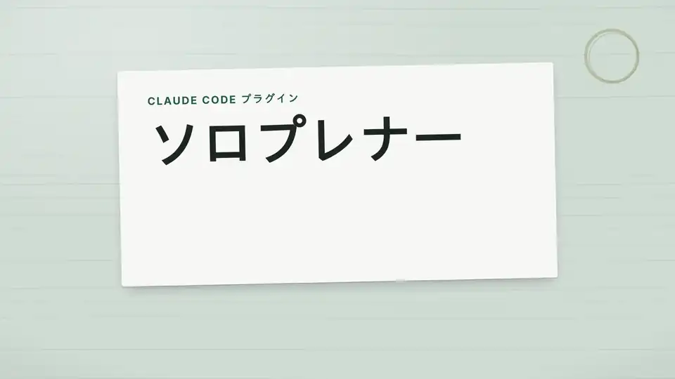

# ぼっちプレナー（bocchi-preneur）v0.17.0

[](https://github.com/iepyon/bocchi-preneur/raw/main/docs/media/bocchi-preneur-intro.mp4)

**3分の紹介動画**：使う人の置かれた状況、困りごと、このプラグインの解決策、使い方を3分にまとめました。上の画像はこのページの中でそのまま動きます（音なし）。音つき（BGM。読み上げはなし）で見るときは、画像を押すと MP4（16MB）が開きます。

社内でプロダクトや新規事業を任されたPM候補・事業責任者の候補（と、非エンジニアの経営者）が、Claude Code と一緒にプロダクトを課題検証から新規事業化（事業として認められるところ）へ進めるのを手伝うプラグイン。外販、社内の新規事業（社内の承認者が予算を出す）、社内ツールのどれでも使える。何をもって事業化とするか（事業化の印）は、本人が最初に決める。

**まだ作っている途中の段階です（v0.x）。** 手順や中身は、試しながらこれからも変えていきます。うまくいかない場面もあると思って使ってください。計測・運用は、いまはスコープ外です。

**決めるのは人、作るのはAI、確かめるのは現場。**
事業判断はAIが1問ずつ問い詰めて本人の言葉で決めてもらう（GrillMe式）。AIが作ったものは、本人が要点と弱点を自分の言葉で説明できてから受け入れる（説明チェック）。本人が引き受けた判断は意思決定ログに残し、工程を通るたびに、読み手（事業責任者など）が5分で読める要約にまとめる。顧客の課題と払う意思は、チャットではなく現場の宿題（インタビュー、事前予約）で確かめる。届けることは初日から並走させる。

> [!WARNING]
> **セキュリティは、AIの点検だけで済ませず、公開前に専門家の助言を受けてください。** このプラグインの攻撃テストとレビューは最低限の自己点検で、専門家の診断の代わりにはなりません。詳しくは下の「注意」を見てください。

## 5工程・10ステップ＋並走トラック
工程の区切りは、本人が責任を持って決める場面に置いている。工程を出るときの条件（工程ゲート）は `skills/bocchi-preneur/references/phase-gates.md`。

| 工程 | ステップ | 工程を出るときに本人が決めること |
|---|---|---|
| 1 調査 | 1. コンセプトと課題検証 🔴＋宿題 | 誰のどの課題か。顧客の行動で確かめられたか |
| 2 企画 | 2. 仕様設計（UXの5レイヤー＋データの重さ）🔴/🟡 | 入れるもの・入れないもの、データの重さ、AI利用の上限 |
| 3 試作 | 3. 画面設計（骨格） 🟡／4. プロトタイプ実装（Web かアーティファクトを先に）🟢 | 何を作れば仮説を検証できるか |
| 4 検証 | 5. 価値検証（行動とコミットで判定）🔴＋宿題／6. 価格設計 🔴 | 進む・作り直す・やめる。いくらで売るか |
| 5 公開 | 7. 本番実装（作るAIと確かめるAIの分業）🟢／8. デザイン（表層） 🟡／9. セキュリティと公開準備 🟢/🔴／10. ローンチ 🟡 | 公開してよいか。残ったリスクを受け入れるか |

並走：届けるトラック（外販のみ）

🔴 本人の言葉でしか埋めない／🟡 AIが案を出し本人が選ぶ／🟢 AIが作り、本人は受け入れ条件を決めて確かめ、自分の言葉で説明する

## 取り込んでいる基準
- 米国の独立開発で定番の考え方：過去の事実を聞く顧客インタビューとコミットによる判定、小さく始めて段階的に大きくする、最初から課金する、人を雇う前に自動化する、多くのアイデアはやめる前提
- 中国の独立開発で定番の考え方：公開しながら作る、無料の小ツールを入り口にする、メールリストに貯める、海外市場の論点（言語・決済・通貨・法令）
- 詳しくは `skills/bocchi-preneur/references/research-basis.md`

## インストール
```
/plugin marketplace add iepyon/bocchi-preneur
/plugin install bocchi-preneur@bocchi-preneur
```
ローカルで試すだけなら、リポジトリのルートで `claude --plugin-dir ./plugins/bocchi-preneur`。

## 始め方
1. プロダクト専用の空のフォルダを1つ作り、そこで Claude Code を開く（1プロダクトに1フォルダ）。
2. `/bocchi-preneur:start 作りたいもの` と入力する。フォルダの準備（変更履歴を残すGitの用意、記録の置き場所 `docs/bocchi/` の作成）はAIが確かめて行う。
3. 中断はいつでもよい。再開は同じフォルダで `/bocchi-preneur:start`。

## 更新
```
/plugin marketplace update bocchi-preneur
/plugin update bocchi-preneur@bocchi-preneur
```

### 旧い名前（solo-preneur）から移る
v0.15.0 で名前が変わったため、旧い名前で入れたものは更新では新しい版になりません。一度外して入れ直してください。
```
/plugin uninstall solo-preneur@solo-preneur
/plugin marketplace remove solo-preneur
/plugin marketplace add iepyon/bocchi-preneur
/plugin install bocchi-preneur@bocchi-preneur
```
進めていたプロダクトのフォルダで `/bocchi-preneur:start` と入力すると、記録の置き場所 `docs/solo/` を `docs/bocchi/` に付け替えてよいかをAIが確かめてから続きを始めます。

## 呼び出せるスキル
入力欄で `/` から呼び出す。AIが自動で呼ぶことはない（本体の bocchi-preneur スキルは話しかけるだけで動く）。

| 呼び出し | 内容 |
|---|---|
| `/bocchi-preneur:start` | 始める／再開する |
| `/bocchi-preneur:next` | ゲートを確認して次へ |
| `/bocchi-preneur:status` | 進行状況・宿題・撤退基準を見る |
| `/bocchi-preneur:step <番号>` | 指定ステップへ |
| `/bocchi-preneur:homework [メモ]` | 現場の宿題の台本づくり／結果の記録 |
| `/bocchi-preneur:review` | 厳しめのコードレビュー |
| `/bocchi-preneur:pentest` | 自分のアプリへのペネトレーションテスト（AIの自己点検。専門家の診断の代わりにはならない。下の「注意」を参照） |
| `/bocchi-preneur:rca <症状>` | 根本原因分析（実装はしない） |

## 構成
```
.claude-plugin/      plugin.json
agents/              strict-reviewer, pentester, root-cause-analyst
skills/
  bocchi-preneur/      本体
    SKILL.md         思想・絶対ルール・分岐・進め方・references の一覧（どのステップで何を読むか）
    references/      ステップ別の詳細、phase-gates（工程ゲート）、explain-check（説明チェック）、decision-log（意思決定ログ）、manager-report（読み手への要約）、ux-layers（UXの5レイヤー）、interview-kit、disposable-html、track-distribution、research-basis、migrations（旧い版の付け替え）
    templates/       state.md、decision.md（意思決定ログ）、report.md（読み手への要約）
  start/ next/ status/ step/ homework/
                     / で呼び出す入口。本体の SKILL.md を ${CLAUDE_PLUGIN_ROOT} から読み込み、その手順に従う
  review/ pentest/ rca/
                     / で呼び出す入口。エージェントに任せる
```

決まりと手順は本体の SKILL.md と references にだけ書き、入口には書かない。references は SKILL.md から1段だけたどり、references どうしは参照し合わない。変更したら、リポジトリのルートで `python3 tools/check-refs.py` を流して参照の切れや入れ子がないことを確かめる。

シミュレーション記録と回帰テスト用シナリオは、利用者の環境に入らないようリポジトリ直下の `simulations/` に置いている。

## 変更履歴
- v0.17.0：現場の宿題を消さず、「まとめて進めて」でも問い詰めを抜かないようにした（シミュレーション Round 5 の R5-6・R5-7、方針は `samples/bocchi-preneur/decisions/05`）。想定インタビューは1回目は断り、2回目に頼まれたら作る。作ったら、本物に聞く1人目と期限を本人に決めてもらい、state.md の宿題欄・意思決定ログ・Git のコミット・report.md に「未着手（想定で代用中）」として残し、再開のたびに示す。ステップ1の課題検証を本物の記録で満たすまでステップ5に、ステップ5を本物の結果で満たすまでステップ7に入れない（本人の押し切りでも入れない、唯一の例外）。「まとめて進めて」は公開に近いほど狭め、検証・公開では受け付けない（SKILL.md ルール4・9・13・14、`interview-kit.md`、`explain-check.md`、`05-value-test.md`、`07-build.md`、`decision-log.md`、`manager-report.md`、`migrations.md`、state.md の雛形、status、homework）
- v0.16.0：対象を社内のPM候補・事業責任者の候補に合わせ、ゴールを新規事業化にした（シミュレーション Round 5 の R5-4・R5-18、方針は `samples/bocchi-preneur/decisions/01`・`02`）。開始時の分岐を「外販／社内の新規事業／社内ツール」の3つにし、社内の新規事業では最初の利用者（社外／社内）と承認者を聞く。上司から任された案件で外販を選んだら、社内の新規事業ではないかを1回だけ確かめる。ステップ1で撤退基準と対にして「事業化の印」（何をもって事業として認められたとするか）を本人に決めてもらい、ステップ6で承認者・予算とあわせて照らし直し、ローンチのあとに本人が達成・未達を判定して完了する。分岐の「目標」は事業化の印に置き換えた。説明文・エージェントの「非エンジニアの経営者」を直した（SKILL.md、`01-concept.md`、`05-value-test.md`、`06-pricing.md`、`10-launch.md`、`phase-gates.md`、`track-distribution.md`、`09-security.md`、`migrations.md`、state.md の雛形、status、agents、plugin.json、README）
- v0.15.0：名前を「ソロプレナー（solo-preneur）」から「ぼっちプレナー（bocchi-preneur）」に変えた。リポジトリは `iepyon/bocchi-preneur`、マーケットプレイスとプラグインは `bocchi-preneur@bocchi-preneur`、呼び出しは `/bocchi-preneur:start` など、本人の記録の置き場所は `docs/bocchi/`（終えたプロダクトは `docs/bocchi-archive/`）になった。旧い名前で入れていた人は、上の「旧い名前（solo-preneur）から移る」の手順で入れ直す。`docs/solo/` で進めていたプロダクトは、再開時に本人に確認してから `docs/bocchi/` に付け替える（`migrations.md`）。紹介動画（MP4・README で動く WebP・サムネイル）も、映像の中の名前と URL・コマンドを新しい名前に差し替えた
- v0.14.2：セキュリティに強めの注意書きを入れた。AIのレビューとペネトレーションテストは専門家の診断の代わりにならないこと、公開前に専門家の助言を受けることを、ステップ9の冒頭で必ず本人に伝える。データの重さが「重」、または決済・ログインがあるなら、専門家の診断が済むまで公開工程のゲートを閉じない（受けずに公開すると本人が決めたなら、理由と残るリスクを意思決定ログと report.md に残す）。AIは「安全です」と言わない（`09-security.md`、SKILL.md、`phase-gates.md`、pentest、pentester、README）
- v0.14.1：v0.14 の動作確認（`simulations/v0.14-check.md`）で見つかった、旧い版の記録の扱いを直した。`migrations.md` に v0.11〜v0.13 の付け替え（保守の行とステップ11、本人の説明、意思決定ログと report.md）を足し、旧い版で通ったゲートに新しい記録を遡って求めないようにした。status も同じ考え方で表示する
- v0.14.0：構成を見直した。入口のスキル（start・next・status・step・homework）が本体の references を自分のフォルダから探して見つけられなかった問題を直した。入口は本体の SKILL.md を `${CLAUDE_PLUGIN_ROOT}` から読み込み、手順は本体の「セッション開始時」「ゲートを確かめて次へ進む」「ステップを移動する・飛ばしたいと言われたら」に1つにまとめた。スキル作成のベストプラクティスに合わせ、references は SKILL.md から1段にした（SKILL.md に references の一覧と、ステップごとの「読むもの」を置き、references どうしの参照をなくした）。本人の記録は `docs/bocchi/…` と書いて references と区別した。説明文を三人称にして使う場面を `when_to_use` に分け、SKILL.md の見出しから版番号を外し、旧い版の付け替えは `migrations.md` に、スコープ外の `11-metrics.md` はプラグインの外（リポジトリの `archive/`）に移した。工程ゲートに目次を付け、参照を確かめるスクリプト `tools/check-refs.py` を加えた
- v0.13.0：判断の記録を入れた（シミュレーション Round 5 の R5-2・R5-3・R5-5）。本人が引き受けた判断（工程の判断、対象の変更、入れる・入れない、技術の選択、ゲートを満たさずに進むこと、基準の変更、進む・作り直す・やめる）を `docs/bocchi/decisions/` に1件ずつ残す。本人の理由は本人の言葉で、記号だけでは残さない。工程を通るたびに、読み手が5分で読める要約 `docs/bocchi/report.md`（冒頭5行：今どこ・何を決めた・何が外れてどう戻ったか・次に何を確かめるか・何がほしいか）を更新し、本人が約束していないことは書かない。価値検証の判断のあとは、進む・作り直す・やめるのどれでも学び3行を書く。作り直すときは、戻り先・2回目の合格基準・新しい撤退基準を決め、戻ったら下の層を直してゲートを確かめ直す（SKILL.md ルール12・「作り直すと決めたら」、`decision-log.md`、`manager-report.md`、`05-value-test.md`、`phase-gates.md`、templates、next・status）
- v0.12.0：説明チェックを入れた（シミュレーション Round 5 の R5-1）。AIが作ったもの（仕様の下書き・骨格・試作品・試算・本番のしくみ・攻撃テストの結果と規約・素材）をゲートで受け入れる前に、本人が自分の言葉で要点と弱点を言う。公開工程では、弱点を直すか受け入れるかも決める。AIは答えを言わず、見る場所を示して問い返す。「まとめて進めて」でも省かない。飛ばしたら「説明待ち」としてゲートを閉じず、工程ゲートの前に必ず済ませる。結果は各成果物の「本人の説明」に残す（SKILL.md ルール11、`explain-check.md`、各ステップのゲート、`phase-gates.md`、state.md の状態、start・next・status）。🟡で選んだ理由も、記号ではなく本人の言葉で残す
- v0.11.0：ゴールをローンチ（リリース）までに絞った。計測・運用・継続判断（旧 6 保守・ステップ11）はスコープ外とし、`11-metrics.md` は将来のために残す。公開工程を出たら、振り返り・ローンチした日と最初の反応の記録をして完了する（SKILL.md「ゴール」）。5工程・10ステップに改め、state.md の雛形、step・status・next、工程ゲート、説明を合わせて直した
- v0.10.0：シミュレーション Round 4 の課題を反映。利用者どうしの関わりが価値になるプロダクトでは、戦略で最小の密度を決め、価値検証で密度を作る方法を先に決める（R4-1）。利用者の書き込みがほかの人に見えるなら、困った書き込みを止める方法をコンテンツの要件で決め、公開準備で通報と削除の基準を確かめる（R4-2）。利用者どうしが関わる機能は、2人以上を同時に動かすテストを最低1本入れる（R4-3）
- v0.9.1：ステップ4の最初の作り方に、Web と並べて Claude のアーティファクトを加えた（サンプル「ひとりび」で、限られた人での価値検証ならアーティファクトで足りたため）。どちらにするかは比較を示して本人が選ぶ
- v0.9.0：UXの5レイヤーを層の中身まで扱うようにした（`ux-layers.md` を追加）。戦略に成功の指標、要件に機能の仕様とコンテンツの要件、構造に情報の構造と操作の設計、骨格に部品配置・移動・情報の見せ方と初回・空・失敗の状態、表層に骨格との一致・読みやすさ・一貫性の確認を加えた。層の対応表で戦略から見た目までのつながりを追い、上の層で機能を足したくなったら先に要件に戻るルールを入れた
- v0.8.0：工程ゲートを `phase-gates.md` に書き出した（全工程に共通する条件、工程として確かめること、工程の判断、満たせないときの戻り先）。next が工程の最後で工程ゲートを確かめ、判断を state.md の「工程の判断」に記録するようにした。status に工程ゲートの未達を表示
- v0.7.0：11ステップを6工程（調査・企画・試作・検証・公開・保守）に束ねた。価格設計を本番実装の前に移し、番号とファイル名を振り直した（6 価格設計 `06-pricing.md`、7 本番実装 `07-build.md`）。届けるトラックのチェックポイント3は検証の終わり（ステップ6）に移動。旧い番号の state.md は、再開時に本人の確認を得て付け替える
- v0.6.1：はじめの準備（00-setup）を現状に合わせて書き直し（インストール手順、専用フォルダ、Gitでの履歴、作られるファイル、再開と更新）。start の開始時の分岐を「自由に話す→要約→4問を1回で」に揃え、README に始め方と更新を追加
- v0.6.0：コマンド8本（start・next・status・step・homework・review・pentest・rca）をスキルに移行。呼び出し方（`/bocchi-preneur:start` など）は変わらない
- v0.5.1：ステップ2（仕様設計）の見出しから人名を除去
- v0.5：名前を solo-preneur に変更。人名・出典元の固有名を除去。実際のお金を受け取る事前予約の前に、最低限の公開準備（返金方針・特商法表記・プライバシーポリシー）を前倒しするよう修正。待機リストLPにメールの利用目的を明記。宿題待ちの再開とステップ移動時の最小限チェックを修正
- v0.3：米中のプロの基準を取り込み、3ラウンドのシミュレーションで見つかった22件の破綻を修正
- v0.1：初版

## 注意
> [!WARNING]
> **セキュリティは専門家の助言を受けてください。** セキュリティは、このプラグインで扱う中で最もリスクが高い領域です。穴があると、利用者の個人情報やお金が漏れ、事業が続けられなくなることがあります。このプラグインのレビュー（`/bocchi-preneur:review`）とペネトレーションテスト（`/bocchi-preneur:pentest`）は、AIによる最低限の自己点検で、**専門家の診断の代わりにはなりません**。AIのテストで問題が見つからなくても、安全とは限りません。公開前に、セキュリティの専門家（脆弱性診断の事業者、セキュリティに詳しいエンジニアなど）の助言を受けてください。個人情報・決済・ログイン・健康情報を扱う場合は、専門家の診断を受けてから公開してください。

法務（規約、特商法表記、海外の法令）や税について、AIは下書きと論点整理まではするが、法的助言はしない。課金や重いデータを扱う場合は専門家への確認を勧める設計にしている。
