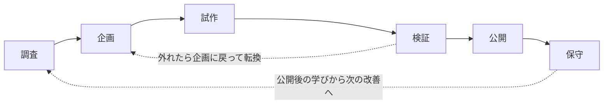
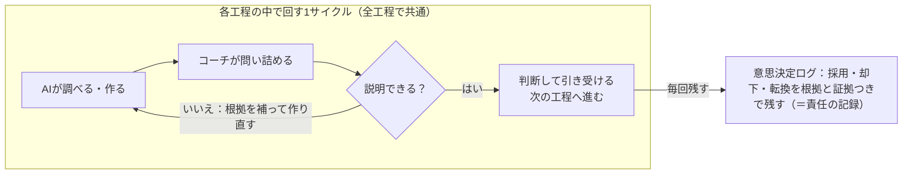

# 企画書：AI前提で通しきる「ぼっち」を育てる学習プロダクト（仮）

2026-11-15 時点

## エグゼクティブサマリー

本企画は、AIが下積み仕事を肩代わりしたことで途切れた「判断力を身につける経路」を、実物の小さなプロダクトをぼっちで通しきる訓練として作り直すものである。プロダクト名は仮に「ぼっちプレナー」とする。

- **課題**：プロダクトマネージャーは調査から運用まで通して判断した経験でしか育たないが、その経験を積ませる場が企業内にない。さらにAIが初級業務を担い、新人が判断を学ぶ経路そのものが細った。
- **解決策**：受講者が社内向けツールや新規事業の小さな実験を、市場調査から公開・保守までぼっちで回す。作業はAIが担い、受講者は判断と結果責任を担う。AIコーチは答えを出さず、問い詰めて根拠を出させる。
- **差別化**：知識を教えるのではなく「責任を引き受けた記録」を残す。意思決定ログと検証の証拠が、そのまま「任せられるか」の判断材料になる。
- **ターゲット**：初期はプロダクトマネージャー育成に悩む企業（買い手は事業責任者、受講者は社内のプロダクトマネージャー候補）。次段に非エンジニアの経営者・事業担当者。
- **MVP**：受講者の道具となるClaude Codeプラグインと、人の伴走をつけた法人向け通しプログラム。2〜3社との共同検証で始める。
- **最初の検証**：「プロダクトマネージャー候補が12週間で社内向けプロダクトを通しで回し、事業責任者が『任せられる』と判断できるか」。

## 背景と課題：学習経路の消失

問題の本質は「仕事が減った」ことではなく、「判断力を育てる低リスクの練習場」が消えたことである。従来の人材育成は、初級業務を任せ、失敗をレビューで拾い、徐々に責任範囲を広げる徒弟制で成り立っていた。AIがその初級業務を最も効率よくこなすため、経路の入口が先に塞がった。

データもこの構造を示している。

| 観測 | 内容 | 出典 |
| --- | --- | --- |
| 入口の縮小 | 米国でAIの影響を強く受ける職種の22〜25歳の雇用が、2022年後半比で相対13%減。同職種の年長層は横ばい〜増加 | [Stanford Digital Economy Lab（報道）](https://leaddev.com/hiring/young-devs-steepest-losses-exposed-roles-stanford-study-finds) |
| 職種別の急減 | 22〜25歳のソフトウェア開発者の雇用は2025年7月までにピーク比で約20%減 | [Constellation Research](https://www.constellationr.com/insights/news/stanford-study-ai-eating-entry-level-jobs) |
| 習得の阻害 | 新しいライブラリをAI支援で学んだ群は、手で書いた群より理解度テストが17%低い（50%対67%）。差が最大だったのはデバッグ | [Anthropic](https://www.anthropic.com/news/AI-assistance-coding-skills) |
| 使い方で差が出る | AIに丸投げした群は40%未満、生成後に「なぜ」を問い返した群は65〜86% | [Anthropic](https://www.anthropic.com/news/AI-assistance-coding-skills) |

ここから三つの課題が導ける。

1. **入口がない**：任される初級業務がないため、実務で判断を磨く機会が生まれない。
2. **AIがあると逆に学べない**：作業をAIに渡すほど、AIの誤りを見抜く力（検証・デバッグ）が育たない。
3. **責任の担い手が育たない**：AIの出力を採用し、結果に責任を持つ判断は、責任を負った経験からしか育たない。だが責任を負わせる場が組織内に用意されていない。

この問題は開発に限らず、調査・企画・マーケティング・デザインなど、AIが初級業務を担えるあらゆる分野で同じ形で起きている。

## 目指す人材像：AI前提で通しきる「ぼっち」

目指すのは、リサーチャー・企画者・開発者・運用者を兼ねる万能人材ではない。各工程の作業をAIに任せたうえで、工程をまたいで「何を採用し、何を捨て、結果をどう引き受けるか」をぼっちで決めきれる人である。本企画では、工程を分業せず、AIを使いながら、リスクを承知の上で決断し、その結果を一人で引き受けて通しきる人を「ぼっち」と呼ぶ。

| 工程 | AIが担うこと | 人が担うこと（責任の中身） |
| --- | --- | --- |
| 市場調査 | 情報収集、要約、競合の洗い出し | 情報源の信頼性の判断、調べる問いの設定 |
| 企画 | 案の大量生成、構成の整理 | 誰のどの課題に賭けるかの決定、やらないことの決定 |
| プロトタイプ | コード・画面・資料の生成 | 何を作れば仮説を検証できるかの見極め、品質の最低ラインの設定 |
| 検証 | インタビュー設計案、データ集計 | 事実と願望の切り分け、続行・転換・中止の判断 |
| ローンチ | 文章、LP、設定作業 | 公開してよいかの判断、利用者への約束の明示 |
| 保守 | 不具合の調査、修正案、監視 | 障害時の判断と説明、続けるかやめるかの決定 |

共通する能力は三つに絞れる。

- **問いを立てる力**：AIに何を頼むかを決める力。曖昧な依頼からは曖昧な成果しか出ない。
- **見抜く力**：AIの出力の誤り・根拠の弱さ・抜けを見つける力。先の研究で最も差が出たデバッグ力に相当する。
- **リスクを承知で決断する力**：情報が揃いきらない中でリスクを見積もり、それを承知の上で自分の名前で決め、結果を説明し、外れたら修正する力。リスクをゼロにしてから動くのではなく、どこまでなら負えるかを決めて動けることが核になる。

この人材像は、企業におけるプロダクトマネージャーの役割とほぼ重なる。本プロダクトは「AI前提で動けるプロダクトマネージャー」を育てる仕組みとして位置づける。到達基準は、米国・中国のプロのぼっちプレナーが実際に回している水準とする。

## ターゲットと市場

初期は、プロダクトマネージャー育成に悩む企業に絞る。買い手は事業責任者、受講者は社内のプロダクトマネージャー候補とする。非エンジニアの経営者は、プラグインを使う次段のセグメントとして残す。

| 段階 | セグメント | 抱えている痛み | 支払い主体 |
| --- | --- | --- | --- |
| 初期（買い手） | プロダクトマネージャー育成に悩む企業の事業責任者（新規事業・プロダクト組織を持つ企業） | プロダクトマネージャー候補を育てたいが、通しで任せられる案件がない。研修を受けさせても実務で判断できるようにならない | 企業（事業部の育成予算） |
| 初期（受講者） | 社内のプロダクトマネージャー候補（エンジニア・企画職・営業などからの転向者） | 企画から運用まで、自分の判断で回した経験がない | 企業 |
| 次段 | 非エンジニアの経営者・個人事業主 | 外注せずに自社ツールや新規事業を試したいが、AIに任せた成果物の良し悪しを判断できない | 本人 |
| 次段 | 若手エンジニア・新卒 | 初級業務がAIに置き換わり、判断を学ぶ案件に入れない | 企業（育成部門） |
| 将来 | 学校・リスキリング事業者 | 修了者の実務力を示す手段がない | 教育機関・行政 |

市場規模は未検証のため、本企画では次の二つの手掛かりのみ置く。

- プロダクトマネージャー育成の需要：プロダクトマネージャー不足と育成の難しさは多くの企業が抱える課題で、既存のプロダクトマネージャー研修や外部講座の予算を付け替えて入れる余地がある（規模は未調査）。
- 公的支援：政府はリスキリング支援に5年で1兆円規模を投じる方針を2022年に示している（記憶に基づく概算、要確認）。

- [ ] プロダクトマネージャー育成に悩む企業の数と、プロダクトマネージャー研修・外部講座に使っている予算の相場を調べる
- [ ] 事業責任者5名に、プロダクトマネージャー候補を今どう育てていて、どこで止まっているかを聞く
- [ ] 次段の非エンジニア経営者のうち、自社でAI開発を試す意向がある層の規模を調べる

## プロダクトコンセプトと提供価値

コンセプトは「AIが手を動かし、あなたが決めて引き受ける。その記録が実力になる」である。消えた徒弟制を、AIコーチと実物のプロダクトで置き換える。

徒弟制の要素と、本プロダクトでの置き換えは次のとおり。

| 徒弟制にあったもの | 本プロダクトでの置き換え |
| --- | --- |
| 任される小さな仕事 | 学習者自身の小さなプロダクト（実際に公開し、実際の利用者がいる） |
| 先輩のレビュー | 答えを出さず、根拠を問い詰めるAIコーチ |
| 失敗が許される範囲 | 小さく始めて段階的に公開範囲を広げる設計 |
| 「あいつは任せられる」という評判 | 意思決定ログと検証の証拠をまとめた「責任の記録」 |

提供価値は利用者ごとに異なる。

- **事業責任者（買い手）**：プロダクトマネージャー候補に「任せられるか」を、研修の修了ではなく実際の判断の記録で見極められる。育成の進み具合も同じ記録で追える。
- **プロダクトマネージャー候補（受講者）**：社内で使われるプロダクトが手に残り、通しで回した経験とその証拠が得られる。
- **非エンジニアの経営者（次段）**：同じプラグインで、外注せずに自分の事業のプロダクトを通しで回せる。

AIを使うほど学べなくなる問題に対しては、AIの使い方そのものを設計で縛る。生成させたら必ず「なぜこれで良いか」を説明させ、説明できない成果物は次の工程に進めない。

## 学習モデル：実案件ループ×問い詰め×責任の可視化

学習の単位は講座ではなく、学習者自身の1プロダクトである。全工程で同じサイクルを回し、AIの成果物を自分の言葉で説明できたときだけ次へ進む。

**図：学習モデル · 6工程と各工程内のサイクル**（各工程で、AIの成果物を説明できるまで次に進まない）

設計の根拠は、AIの使い方で習得度が大きく変わるという知見にある。生成させた後に理解のための問いを重ねた人は理解度が高く、丸投げした人は低かった。本モデルはこの「生成してから理解する」使い方を、工程ゲートで強制する。

- **実物を通す**：練習用の課題ではなく、実際に公開し利用者がいるプロダクトを扱う。責任は本物の利用者がいて初めて生じる。
- **問い詰めの強度を変える**：調査・企画では易しく、公開前と保守では厳しくする。
- **責任を見える形にする**：判断のたびに意思決定ログへ残し、外れた判断もそのまま残す。外れをどう扱ったかが一番の実力の証拠になる。

## 機能構成とMVP範囲

MVPは二層で作る。受講者の道具はClaude Codeプラグインとし、受講者のリポジトリ内で完結させる。その上に、人の伴走と事業責任者への報告をつけた法人向け通しプログラムを載せる。

| 機能 | 内容 | MVP |
| --- | --- | --- |
| 工程ナビ | 11ステップを6工程（調査・企画・試作・検証・公開・保守）に束ね、現在地と次の一手を示す | 含む |
| 問い詰めコーチ | 答えを出さず「根拠は」「誰に確かめた」「外れたらどうする」を問う。GrillMe式の振る舞い | 含む |
| 工程ゲート | 次工程へ進む条件（例：検証前に仮説と判定基準が書かれている）を満たすまで先に進ませない | 含む |
| 説明チェック | AIが生成したコードや資料について、受講者に要点と弱点を説明させる | 含む |
| 意思決定ログ | 採用・却下・転換の判断を、根拠と証拠つきでリポジトリに自動記録する | 含む |
| 題材設定 | 事業責任者と、社内向けツールや新規事業の小さな実験から題材と公開範囲を決める | 含む（人が実施） |
| 伴走レビュー | 週1回、人が意思決定ログを読み、判断の質にフィードバックする | 含む（人が実施） |
| 事業責任者レポート | 受講者ごとの判断の記録と進み具合を、事業責任者が読める形にまとめる | 含む（手作業で開始） |
| 障害演習 | 公開後に想定障害を起こし、判断と利用者への説明を練習させる | 次段 |
| 法人向け管理画面 | 受講者の進捗と判断の質を一覧で見られる画面 | 将来 |

MVPでは作らないものも明確にする。コミュニティ機能、認定制度、動画教材は作らない。プラグイン内に人名や出典元の固有名は入れない。

## 競合・代替手段と差別化

競合は「知識を教えるもの」か「作業を代わるもの」のどちらかに寄っており、「判断と責任を練習させるもの」は空いている。

| 代替手段 | 得られるもの | 足りないもの |
| --- | --- | --- |
| プロダクトマネージャー研修・プロダクトマネージャー講座 | プロダクトマネージャーの知識、フレームワーク | 自分の判断で通しきる経験がない。修了しても任せられるかは分からない |
| オンライン講座・動画 | 知識、手順 | 自分の案件で判断する経験がない |
| プログラミングスクール | コードを書く力 | AIが書く前提での検証・判断の訓練が薄い。工程が開発に偏る |
| AIツールの学習モード | 理解を促す説明 | 工程をまたぐ通しの経験と、責任の記録がない |
| ハッカソン・起業プログラム | 通しの経験 | 短期で終わり、保守と運用を経験しない |
| 社内OJT | 実務の判断 | 初級業務がAIに移り、任せる仕事自体が減っている。プロダクトマネージャーの仕事は小さく切り出しにくい |

差別化の軸は三つである。

1. **公開して終わらない**：保守と運用まで含めて「通し」とする。責任が最も問われるのは公開後だからである。
2. **答えを出さないAI**：生産性ではなく判断力の形成を目的にAIの振る舞いを設計する。
3. **記録が資産になる**：修了証ではなく、判断の履歴そのものを実力の証明にする。

## ビジネスモデル

収益の柱は、プロダクトマネージャー育成に悩む企業向けの伴走付き通しプログラムである。プラグイン本体は公開して、次段の非エンジニア経営者への入口と評判づくりに使う。価格はすべて仮置きで、検証で決める。

| 収益源 | 対象 | 形態 | 位置づけ |
| --- | --- | --- | --- |
| 法人向け通しプログラム | プロダクトマネージャー育成に悩む企業 | 12週間のコホート制、週1回の伴走レビュー、事業責任者への報告 | 初期の主収益 |
| 共同検証枠 | 最初の2〜3社 | 無償または低額で提供し、事例と評価基準づくりに協力してもらう | 初期の入口 |
| プラグイン本体 | 個人・非エンジニア経営者 | 無償公開（GitHub） | 次段への入口と評判づくり |
| 個人向け伴走プログラム | 非エンジニア経営者 | 少人数コホート | 次段の収益 |
| 責任の記録の発行 | 修了者・採用企業 | 第三者が確認できる形式での記録発行 | 将来 |

AI利用料は学習者自身の契約で負担してもらい、原価に乗せない。人によるレビューが原価の大半になるため、AIコーチで担える範囲を広げるほど利益率が上がる構造にする。

## 検証計画：仮説・実験・KPI

最初に確かめるべきは「売れるか」より前に「この方法で本当に通しきれる人が育つか」である。育たなければ何を売っても続かない。

| # | 仮説 | 実験 | 合格ライン（仮） |
| --- | --- | --- | --- |
| H1 | プロダクトマネージャー候補が、AIコーチと伴走付きで12週間以内に社内向けプロダクトを公開できる | 2〜3社の共同検証で、計10名程度に通してもらう | 受講者の6割以上が公開 |
| H2 | 公開後の保守まで自力で回せる | 公開後4週間、障害対応と改善を記録 | 公開者の半数以上が障害を自力で一次対応 |
| H3 | 問い詰めがあるほうが判断力が育つ | 問い詰めあり／なしで比較し、終了時に「AIの誤りを見抜く」課題を出す | あり群の正答率がなし群を明確に上回る |
| H4 | 問い詰めは嫌われず、続けられる | 週ごとの継続率と離脱理由を聞く | 12週間の継続率70%以上 |
| H5 | 事業責任者が、意思決定ログで「任せられるか」を判断できる | 終了時に事業責任者がログを読み、受講者ごとに判断する | 参加企業の過半で「判断に使えた」と回答 |
| H6 | 企業が有償で継続・拡大する | 共同検証の後に有償の次期コホートを提案する | 参加企業のうち1社以上が有償で継続 |
| H7 | 非エンジニア経営者もプラグインだけで通せる（次段） | 無償公開後に自走した利用者の公開数を追う | 次段で設定 |

検証の順番はH1とH4を先、H3を並行、H5は共同検証の終了時、H6はその後に着手する。H7は法人向けが軌道に乗ってから扱う。各仮説の結果は意思決定ログと同じ形式で記録し、プロダクト自身の作り方にも同じ規律を適用する。

## ロードマップ

有償で売り始めるのはゲートBを越えてからである。共同検証で「プロダクトマネージャー候補が通しきれるように育ち、事業責任者が任せられると判断できる」ことが確かめられなければ、有償化も個人向け展開も行わない。

**図：ロードマップ · 4フェーズと3つのゲート（期間は仮）**（まず自分で通し、共同検証で育つかを確かめてから売る）

| フェーズ | 期間（仮） | 内容 | 次へ進むゲート |
| --- | --- | --- | --- |
| フェーズ0：自分で通す | 1か月目 | 問い詰めコーチと意思決定ログの最小版。自分で1つ公開する | ゲートA：自分で公開し、保守まで回せた |
| フェーズ1：2〜3社で共同検証 | 2〜5か月目 | 受講者10名程度。12週間の通し実践。H1〜H5を検証 | ゲートB（最重要）：受講者の6割が公開、責任者が任せられると判断 |
| フェーズ2：有償で広げる | 6〜9か月目 | 法人の有償コホート。障害演習と責任の記録を追加、H6検証 | ゲートC：1社以上が有償で継続、保守を自力で対応 |
| フェーズ3：経営者へ広げる | 10か月目〜 | プラグインを公開し、個人向け伴走を開始。H7を検証 | — |

各ゲートを越えられない場合は、次のフェーズに進まず前のフェーズをやり直す。期間はすべて仮置きである。

## リスクと対策

最大のリスクは、問い詰めが「面倒な関所」に見えて学習者がAIに丸投げする抜け道を探すことである。

| リスク | 起きること | 対策 |
| --- | --- | --- |
| 丸投げへの回帰 | 受講者がコーチを使わず、別のAIで作業だけ済ませる | ゲートを成果物ではなく説明に置く。説明できなければ記録に残らない |
| 外に出せない | 企業の受講者が、自社名でプロダクトを外部公開できない | 題材を社内向けツールや新規事業の小さな実験にし、公開範囲を事業責任者と最初に決める |
| 法人の意思決定が遅い | 契約や情報セキュリティ審査に時間がかかり、検証が進まない | 最初の2〜3社は共同検証枠で入り、受講者の手元環境で完結する構成にする |
| 買い手と使い手のずれ | 事業責任者の期待と、受講者の負担感が食い違う | 事業責任者レポートで判断の記録を共有し、期待値を開始時に合意する |
| 問い詰めの負担 | 受講者が萎縮し、離脱する | 工程ごとに強度を調整する。初回は易しく、公開前と保守で厳しくする |
| 実利用者による損害 | 公開したプロダクトの不具合で利用者に迷惑がかかる | 公開範囲を段階的に広げる。個人情報や決済を扱う題材は初期は避ける |
| 記録の信頼性 | 意思決定ログが後から作文される | 記録はリポジトリの履歴と結びつけ、改ざんの痕跡が残る形にする |
| AIの進化 | AIが判断まで担い、訓練の前提が崩れる | 「最後に引き受ける人」は残る前提に立つ。判断の比重が増すほど本プロダクトの価値は上がる |
| 単一ツール依存 | Claude Codeの仕様変更で動かなくなる | 工程・ゲート・記録の設計をツールから切り離して文書化しておく |

## 未検証の前提と次のアクション

本企画の中身は大半が未検証の仮説である。特に次の三つが崩れると企画全体の組み直しが必要になる。

- 事業責任者が「プロダクトマネージャー候補に通しの経験を積ませたい」と考えている（「プロダクトマネージャーの知識を教えてほしい」だけかもしれない）
- 社内向けの題材でも、受講者に責任の重みが生まれる
- 問い詰めによる判断力の伸びを、12週間で測れる
- 意思決定ログを、事業責任者が読んで「任せられるか」の判断に使える

次の一手は以下のとおり。

- [ ] プロダクトマネージャー育成に悩む企業の事業責任者5名に、プロダクトマネージャー候補を今どう育てていて、どこで止まっているかを聞く（願望ではなく過去の行動を聞く）
- [ ] 11ステップを6工程にどう束ねるかを確定し、各工程のゲート条件を書き出す
- [ ] 問い詰めコーチと意思決定ログだけを持つ最小版を作り、自分で1プロダクトを通して試す
- [ ] 共同検証に参加する企業を2〜3社募り、題材と公開範囲を決める
- [ ] 市場規模とプロダクトマネージャー研修予算の調査を行い、ターゲットと市場の節を更新する
