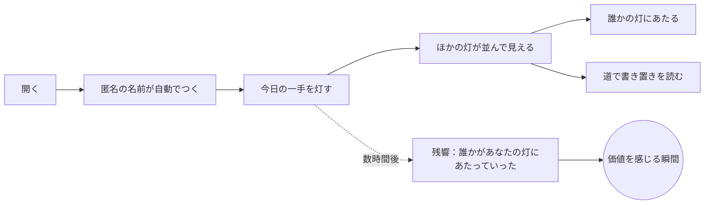

# 仕様設計（UXの5レイヤー 戦略・要件・構造）

> 架空のシミュレーション。プラグイン v0.9.0 の `02-spec.md` と `ux-layers.md` に沿って作成。

## 戦略 🔴

- **対象**：「本業のスキマ時間に、勤め先の新規事業の種を作っている人」（2026-11-15 本人が見直し。`decisions/05-target-intrapreneur.md`）
  - 別プロダクトの候補として記録：本業の外で、自分個人の事業の種を作っている会社員
  - **01-concept.md と矛盾**：コンセプトの対象は「独立1〜2年目を含む、自分のサービスを作る人」のまま。どちらを直すかは戦略を見直し終えたら本人に聞く（SKILL.md ルール8）
- **ユーザーのニーズ**：「他人がやっている雰囲気に勇気づけられて続け、誰にも相談できず手が止まったときは、同じ立場で一度通した人のひとことで、単独ではできない判断をできるようになりたい」（2026-11-15 本人が見直し。前段＝止まらずに続ける、後段＝止まったら動き出す）
  - 前段の本人の言葉：「他人がやってる雰囲気で自分も勇気づけられて続けたい」【推測】
  - 場面：上司に途中経過を見せる前、誰にも相談できず手が止まった【推測】
  - 今の対処：AIに聞いたが、それで合っているか単独では判断できなかった【推測】
  - 欲しかったもの：同じ立場で一度通した人の、15分のひとこと【推測】
  - 旧版：「夜に詰まったとき、誰かに見られている感じなしに、ひとりではないと分かりたい。たまに、少しだけ誰かの手を借りたい」
- **提供価値**：「同じ立場の人たちがやっている雰囲気の中にいて、手が止まったらその場で一度通した人に15分だけ声をかけられる」（2026-11-15 本人が見直し）
  - 匿名は価値にしない。本人の判断：「名前や経歴を出したほうが『一度通した人』だと信用できる。匿名にこだわらない」（選択肢の文を本人が選んだもの）
  - **影響**：要件と `decisions/02-no-follow-no-dm.md`（プロフィールを作らない）、データの重さ（氏名・経歴は「中」）、社外秘の書き込みの扱いを、要件の層で見直す
  - 旧版：「名前も顔も出さずに、同じ夜に作っている誰かの気配と、先に歩いた人の短い助言が手に入る」
- **事業としての目的**：（見直し中）
  - お金の出どころ：「会社の新規事業予算から払ってもらう」（2026-11-15 本人）【推測】
  - 使う人（新規事業の種を作る会社員）と、払うと決める人が別になる。払うと決める人を確かめている途中
  - 旧版：「まずは自分が毎晩使うものを作り切る。続けば、作業会や勉強会と組んで小さく課金する」
- **成功の指標**：「試作品を渡した人のうち、2週間後もまだ週3日以上、灯をともしている人の割合」。撤退基準と同じ数字を使う（20人中5人）

## 要件 🔴

### 機能の仕様（優先度順）

| # | 機能 | 何をするか | 何をしないか | 戦略とのつながり |
|---|---|---|---|---|
| 1 | 灯 | 今日の一手を40字で1つ宣言する。他人の灯に「あたる」（言葉なしの反応）。24時間で消える。道の各場所に、いまそこにある灯の数を出す（ステップ3で追加） | コメント、いいね数のランキング、過去の灯の履歴 | ひとりではないと分かる |
| 2 | 残響 | 自分の灯・書き置き・痕跡に誰かが反応したことを知らせる。相手が誰かは出さない | 誰が反応したかを出す | 見られている感じなしに、届いたことだけ分かる |
| 3 | 書き置き | 11ステップの各場所に、定型文と語の組み合わせだけで助言を残す。「役に立った」を押せる。14日で消える | 自由記述、返信 | 先に歩いた人の短い助言 |
| 4 | 痕跡 | やめた・方向を変えた場所に、学びを3行（各60字）残す。「頭を下げる」で敬意を送る | 書いた人の名前を出す | 失敗談のほうが役に立つ【推測】 |
| 5 | 救援サイン | 種類（見てほしい・話を聞いてほしい・触ってほしい・並んで作業したい）と時間（15/30分）を選んで出す。応じた1人と期限つきの部屋で話す。終わったら「しぐさ」を1つ送る | 連絡先の交換、部屋の記録を残す、フォロー | 少しだけ誰かの手を借りる |

### コンテンツの要件

| 機能 | 中身 | 誰が用意するか | 更新の頻度 | 1人で回せるか |
|---|---|---|---|---|
| 灯 | 今日の一手（40字） | ユーザー | 毎日 | 運営の手間なし |
| 書き置き | 定型文10種、語32語、つなぎ6語 | 本人が最初に作る | 月1回見直す | 回せる。自由記述をなくしたので、見回りの手間がほぼない |
| 痕跡 | 3行の学び | ユーザー | 随時 | **注意**：自由記述。通報3件で非表示にし、本人は週1回だけ見回る |
| 救援サイン・部屋 | 部屋の会話（140字×n） | ユーザー | 随時 | 部屋は終了10分後に中身ごと消すので、運営は保管も確認もしない |
| 場所の名前 | 11ステップの場所名（問いの荒野など） | 本人 | 変えない | 回せる |
| 見本データ | 試作品用の灯・書き置き・痕跡・サイン | AI（すべて架空） | 試作のみ | — |

問い詰めの記録：「痕跡を自由記述にすると、荒らしの見回りを1人で半年続けられますか」→「週1回なら続けられる。通報3件で自動で隠す仕組みとセットなら受け入れる」

### 今回は入れない
フォロー／DM／プロフィールとアイコン／ランキングや連続記録／通知のプッシュ／課金／スマホアプリ

## 構造 🟡

### 情報の構造

| 区分 | 画面 | 呼び名の理由 |
|---|---|---|
| 今日の自分 | 灯（ホーム） | 「今日の一手」は想定インタビューで出た言葉【推測】。本物のインタビューで相手の言葉を確かめる |
| 道 | 道（11の場所一覧）→ 場所（書き置き・痕跡） | ステップ名だけだと事務的なので、場所名を併記。ステップ名も必ず出す |
| 助け合い | サイン → 合流部屋 | — |
| 自分に返ってきたもの | 残響 | — |

### 利用の流れ（初回から価値を感じる瞬間まで）

価値を感じる瞬間：「灯した数時間後、残響で『誰かがあたっていった』と知ったとき」

### 操作の設計

| 操作 | システムの応え | 失敗したとき | 取り消し |
|---|---|---|---|
| 初めて開く | 登録なしで匿名の名前をつけ、合言葉をブラウザに保存 | 保存できない環境でも、その場では使える | — |
| 灯す | 大きな灯と「あたった人数」に切り替わる | 空欄・41字以上は理由を表示 | 「灯し直す」で上書き |
| あたる | ボタンが「あたった」に変わり、相手の残響に届く | 灯が消えていたら「その灯はもう消えました」 | なし（取り消せない軽い反応にする） |
| 書き置きを残す | 組み立て中の文がその場で見える | 1日5つを超えたら理由を表示 | なし（14日で風化） |
| サインを出す | 「あなたのサイン」に表示。2時間で消える | 2つ目は出せない | 「取り下げる」 |
| サインに応じる | 合流部屋に入り、残り時間を表示 | 先に誰かが応じていたら知らせる | 「しぐさ」を送ると部屋を閉じる |
| 初回でまだ何もない | 「まだ誰もいない。あなたが最初の灯になる」などの文を出す | — | — |

## データの重さ 🔴
**軽**。名前・メール・アイコンを預からない。ブラウザに保存した合言葉（ランダムな文字列）だけで本人を見分ける。

本人の確認：「合言葉を消すと、自分の過去の書き置きに戻れなくなる。それでいい。むしろ、それがこのサービスらしい」

部屋の会話は自由記述なので、利用者が個人情報を書く可能性がある。終了10分後に消すことで、預かる時間を最小にする。

## AI利用の上限
裏でAIは動かさない（原価ゼロ）。

## 層の対応表

| 戦略（ニーズ／目的） | 要件（機能・コンテンツ） | 構造 | 骨格（ステップ3） | 表層（ステップ8で書き足す） |
|---|---|---|---|---|
| ひとりではないと分かる | 灯／一手はユーザーが40字 | 灯（ホーム） | 未灯時：灯すフォームが最上部。灯した後：大きな灯と一手 | |
| ひとりではないと分かる | 灯の一覧／あたる | 灯（ホーム） | 「いま◯つの灯」の数字＋ほかの灯のカード | |
| 見られずに、届いたことだけ分かる | 残響 | 残響 | 新着の印つきの一覧。相手名は出さない | |
| 先に歩いた人の短い助言 | 書き置き／定型文は本人が用意 | 道 → 場所 | 場所ごとの書き置き。役に立った順 | |
| 失敗談のほうが役に立つ【推測】 | 痕跡／3行はユーザー | 道 → 場所 | 書き置きの下。3行の見出しつき | |
| 少しだけ誰かの手を借りる | 救援サイン・合流部屋 | サイン → 部屋 | 出ているサイン一覧と「応じる」。部屋は残り時間が最上部 | |
| （戦略にない）試作の見本 | 見本データ | — | — | |
