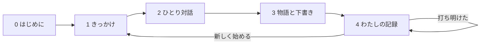

# 画面設計（スキップ。AIの1案を本人が確かめてから実装する）

ステップ3は本人の依頼でスキップした（decisions/03）。案を並べて選ぶ代わりに、AIが1案だけ作り、本人が確かめてから実装する。表層（色・装飾）は作り込まない。

## 主要画面と、その画面で一番大事な情報

| # | 画面 | 一番大事な情報 | 主な部品 | 来た要件 |
|---|---|---|---|---|
| 0 | はじめに（初回だけ） | 何が残り、何が残らないか | 説明3行、記録のきまり、心の不調のときの窓口の案内、「始める」 | データの重さ（decisions/04） |
| 1 | きっかけ | その場で言えなかったこと | 場の選択（ふりかえり／1on1／コミュニティ／飲み会／その他）、言えなかったことの入力欄、「ひとりで話す」 | ニーズ（開くきっかけ） |
| 2 | ひとり対話 | AIの問いと言い換え | 対話の流れ、入力欄、残りの往復回数、「物語にする」（3往復目から） | 必須：喪失を受け入れるひとり対話 |
| 3 | 物語と下書き | 喪失と再生の物語（本人の言葉から） | 物語の編集欄、打ち明けの下書きの編集欄（どの場で誰に話すか）、「自分だけの記録に保存」、「コピー」 | 必須：物語を残す、打ち明けの下書き |
| 4 | わたしの記録 | 保存した下書きと「打ち明けた」 | 保存した物語・下書きの一覧、「打ち明けた」（場と日付を選ぶ）、「新しく始める」 | 撤退基準（「打ち明けた」を押した人で数える） |

## 流れ

## 初回・空・失敗の状態
- 初回：0 はじめに を出す。2回目からは 4 わたしの記録 から始まる
- 空：4 に保存がなければ「まだ記録はありません。言えなかったことから始めましょう」と「始める」
- 失敗：AIの許可がない（対話を使えない旨と、許可のしかた）／混んでいる（少し待ってもう一度）／利用枠を使い切った（今日はここまで。書いた言葉はこの画面に残っている）／往復の上限（「物語にする」へ進む）／記録に書けない（保存できなかった。コピーして手元に残すよう案内）

## 本人の確認
- 本人：「会話はclaudeappのチャットメイんで左動き、視覚的に右何かみせる」【推測】
- 要約：対話は Claude アプリのチャットのように、左側で主役として動く。右側には、何かを目で見える形で見せる。
- AIの受け取り方：5画面を順にめくるのではなく、1画面を左右に分ける。左がひとり対話（きっかけの場の選択も対話の中に置く）。右は「喪失の地図」（失ったもの → 戸惑いと防衛 → 受け止めたこと → これからの自分の4つの駅に、本人が使った言葉の断片が置かれていく）と、物語・下書き、「わたしの記録」のタブ。スマホの幅では「対話」と「地図と記録」を切り替える
- 層の確認（AI）：右の地図は、要件にない新しい部品。戦略の「メタ認知して、誰かに話す準備ができている」と「喪失という過程を包容」につながるので、試作品に入れた。要件（02-spec.md）はスキップ中のため、要件に足すかは本人がステップ2に戻ったときに決める
- 本人が見せたいものが地図でよいかは未確認（試作品を触って確かめる）
