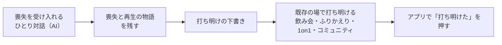

# 企画書：AIで仕事の大切なものを失った人の「自己開示の準備運動」アプリ（名前未定）

2026-11-21 時点

> この企画書は、プラグイン v0.17.0 のステップ1（調査・前半）で本人が答えた内容と、AIが行った机上の市場調査をまとめ直したものです。
> - 「」は本人の言葉、要約：はAIの要約です。証拠ラベル（【推測】【発言】【行動】【コミット】）は `docs/bocchi/01-concept.md` と揃えています。
> - 事業判断（対象、課題、最初の一段、撤退基準）は本人が決めたものだけを書いています。価格、払う人、事業化の印は**まだ決めていない**ので、論点として並べるにとどめています。
> - 市場調査は公開情報の机上調査で、すべて【推測】の扱いです。顧客の現場での確認（課題検証インタビュー）は宿題として残っています。

## エグゼクティブサマリー

本企画は、AIの導入で「自分が仕事で大切にしていたこと」の出番を失い、自信をなくし、防衛的になっているプロダクト開発の担い手に、**打ち明けられるようになるまでの準備運動の場**を用意するものである。

- **課題**：AIを前提に仕事の仕方が刷新され、たとえばアジャイルコーチは、バックログづくりや見積もりの場でファシリテーションや解説の出番を失った【行動】。本人は学び始めているが、「学んでも以前の自分の強みが活かせず、自信を失っている」「以前のやり方にこだわり、防衛的反応を引き起こしてしまう」【推測】。
- **既存の場で足りない理由**：飲み会では戸惑いを語り合うより「まだ優位な所がある」というポジショントークになりがちで、キャリアコーチングは高く弱みを見せる場ではなく、カウンセリングは敷居が高い（「そこまで打ちのめされてない」）。汎用のAIに話しても「一般論の励ましで終わり、自分の物語として腹落ちしない」。
- **解決策**：「喪失を受け入れることの会話をAIに一人対話し、その後周囲に告白の流れ」。アプリは打ち明ける場そのものではなく、その手前の準備運動を受け持つ。
- **最初の版（必須3機能）**：喪失を受け入れるひとり対話（AI）／喪失と再生の物語を残す／打ち明けの下書き。打ち明けるのは、既存の飲み会・ふりかえり・1on1・コミュニティで。
- **ターゲット**：プロダクト開発に関わる仕事をしていて、AIによって自分が仕事で大切にしていたことを失った人たち。代表はアジャイルコーチ。
- **最初の検証**：撤退基準「2027年1月末までに、10人中3人が打ち明けなければやめる」（アプリで「打ち明けた」を押した人で数える）。

## 背景と課題：失ったのは仕事ではなく「出番」

問題の中心は、職を失うことではなく、職に就いたまま「自分らしさを支えていた役割」が静かに消えることにある。本人の観察した場面は次のとおり。

> 訪問先のAIに積極的なエンジニアの現場に参画したアジャイルコーチ。「バックログづくりや見積もりは、ただただAIの対話進行にのっかってすすめることになり、以前のファシリテーションや小ネタの解説ができなくなった」【行動】
> そのあとコーチは「AI前提で刷新される新しい仕事の仕方を学び中」【行動】

最初の像は「身動きが取れない人」だったが、事実の人は止まっていなかった。困りごとは「止まっていること」ではなく、**学びながら抱えている喪失**だと捉え直した（`docs/bocchi/01-concept.md`）。

公開情報も、この構造を裏づける方向にある（机上調査・【推測】）。

| 観測 | 内容 | 出典 |
| --- | --- | --- |
| 国内エンジニアの不安 | ITエンジニア1,007人のうち63.2%が、生成AIの普及が自分のキャリアに影響すると感じている（とても16.6%＋やや46.6%）。AIに任せにくい業務の上位に「チームマネジメント」 | [ラクスパートナーズ調査（MONOist）](https://monoist.itmedia.co.jp/mn/articles/2506/12/news044.html) |
| 職業アイデンティティへの脅威 | ソフトウェアエンジニアは、生成AIによって有能さ・自律・つながりの欲求が脅かされ、若手と熟練で受け止め方が違う。経営のメッセージが意味づけを左右する。本人たちはアイデンティティを守る振る舞いをとる | [Generative AI in the Software Engineering Domain（arXiv:2410.03571）](https://arxiv.org/abs/2410.03571) |
| 声を上げにくい | AIへの懸念を口にしやすいと感じる割合は、個人の担い手59%、管理職72%、経営層84%。現場ほど言いにくい | [Perceptyx](https://blog.perceptyx.com/what-happens-to-professional-identity-when-ai-does-the-work-you-were-known-for) |
| 役割の溶け込み | 英国で「スクラムマスター」の求人が2年で316件から28件に減ったとする分析がある（二次情報）。一方「アジャイルコーチ」の需要はほぼ横ばい。肩書きがデリバリーリードなどに統合されている、AIが調整業務を吸収している、という見方がある（因果は争いあり） | [Scrum.org](https://www.scrum.org/resources/blog/dangerous-middle-agile-roles-ai-will-erode-first)、[unanswered.io](https://unanswered.io/guide/are-companies-getting-rid-of-scrum-masters)、[IT Jobs Watch](https://www.itjobswatch.co.uk/jobs/uk/agile%20coaching.do) |

研究の「アイデンティティを守る振る舞い」は、本人の言う「防衛的反応」と同じ現象を指している可能性が高い。ここから三つの課題が導ける。

1. **喪失に名前がつかない**：職を失ったわけではないので、悲しんでよいと思えず、戸惑いのまま抱えている。
2. **語る場で、かえって鎧を着る**：飲み会では「まだ優位な所があるのポジショントークにとらわれ」、戸惑いをそのまま語れない【推測】。
3. **専門の支援には届かない**：「精神カウンセリングを受けるのはハードルが高く、そこまで打ちのめされてない」。キャリアコーチングは「高いし、弱みを見せる前提の場じゃない」。

## ターゲットと市場

初期は、プロダクト開発の文脈を共有する人に絞る。立場や文脈が違う人が混ざると、飲み会で起きている「まだ優位な所がある」のポジショントークが持ち込まれやすいためである（`decisions/01-target-product-dev-people.md`）。

| 段階 | セグメント | 抱えている痛み | 位置づけ |
| --- | --- | --- | --- |
| 初期（代表） | アジャイルコーチ・スクラムマスター | ファシリテーションや解説の出番を失った | 事実の場面はここから。最初の10人の核 |
| 初期 | プロダクト開発に関わる他の職種（エンジニア、PM、デザイナー） | 自分が仕事で大切にしていたこと（書くこと、決めること、作ること）の出番が減った | 課題検証で2人以上に聞き、対象に含めてよいかを確かめる |
| 別候補 | AIによって新しい働き方に戸惑うエンジニア（単独） | 自分で書くことに支えられていた自分が揺らぐ | 別のプロダクト候補として保留 |
| 将来 | AIに戸惑っている人々（職種を問わない） | 同上 | 本人が最初に挙げた広い像。初期の場が機能してから |

市場規模は未検証のため、手がかりだけ置く（【推測】）。

- 国内の情報処理・通信技術者は約125万人（2020年国勢調査、[IPA](https://www.ipa.go.jp/archive/press/2022/press20230316-2.html)）。民間推計では国内のITエンジニアは154万人（[ヒューマンリソシア](https://atmarkit.itmedia.co.jp/ait/articles/2602/25/news057.html)）。そのうち63%がキャリアへの影響を感じているとすれば、関心層は数十万人規模になりうる。ただし「喪失を抱え、準備運動にお金か時間を使う人」がどれだけいるかは分からない。
- 国内のメンタルヘルスアプリ市場は、2024年の約4.5億米ドルから2033年に約16.6億米ドル（年率15.7%）という予測がある（[Panorama Data Insights](https://www.atpress.ne.jp/news/2604924)）。ただし調査会社によって出発点の数字が2倍以上違う。本企画は治療ではないので、この市場の一部とは言い切れない。

- [ ] 課題検証インタビュー5人以上（コーチ・SM以外から2人以上）で、喪失の場面を【行動】で確かめる（`docs/bocchi/fieldwork/script.md`）
- [ ] 国内のアジャイルコーチ・スクラムマスターの人数の手がかり（資格の保有者数、コミュニティの参加者数）を調べる

## プロダクトコンセプトと提供価値

本人の言葉で言えば、コンセプトは「自己開示の準備運動を丁寧にやりたい」である。

> 「打ち明けの場自体は、既存の飲み会、ふりかえり、1on1、コミュニティでも構わない。自己開示の準備運動を丁寧にやりたい」

要約：打ち明ける場はすでにある。足りないのは、そこで鎧を脱げるようになるまでの準備運動である。アプリは「場」を作らず、既存の場の手前に立つ。

**図：利用の流れ**（アプリが受け持つのは左の3つ。打ち明けるのはアプリの外）

汎用のAIとの違いは、文章の質ではなく「流れ」にある。

| 汎用のAIに打ち明けた場合 | このアプリ |
| --- | --- |
| 「一般論の励ましで終わり、自分の物語として腹落ちしない」 | 喪失を受け入れることに的を絞った問いかけで、自分の仕事で大切にしていたものを言葉にする |
| 対話はそこで終わる | 物語と下書きを手に、周囲に打ち明けるところまでつながる |

提供価値（【推測】。課題検証で確かめる）：

- **利用者**：戸惑いを鎧なしで言葉にでき、身近な場で一度打ち明けられる。
- **利用者の周囲（チーム・上司・コミュニティ）**：防衛的な反応の裏にある喪失を知り、関わり方を変えるきっかけを得る。

## 機能構成とMVP範囲

| 機能 | 内容 | MVP |
| --- | --- | --- |
| 喪失を受け入れるひとり対話（AI） | 仕事で大切にしていたこと、失った場面、戸惑いをAIが問いかけ、受け止める。励ましや助言で終わらせない | 含む（必須） |
| 喪失と再生の物語を残す | 対話から、本人の「喪失と再生の物語」を一編にまとめて残す | 含む（必須） |
| 打ち明けの下書き | 周囲に打ち明ける短い文を、本人と一緒に作る | 含む（必須） |
| 「打ち明けた」を押す | 撤退基準を数えるための申告。誰に・どの場で、を選ばせるかはステップ2で決める | 含む（撤退基準のため） |
| 専門の窓口への案内 | 強い落ち込みのサインが出たときに、専門の相談窓口を示す | 含む（ステップ2で中身を決める） |
| アプリ内で仲間に打ち明ける・受け止める | 同じ文脈の仲間に打ち明け、仲間は評価や助言ではなく「受け止めた」を返す | 次の版（`decisions/02`） |

MVPで作らないもの：アプリ内の打ち明けの場、ランキングや比較、診断・治療をうたう機能。

## 競合・代替手段と差別化

競合は「打ち明ける場」か「ひとりで書く道具」のどちらかに寄っており、**ひとりで書いたものを、身近な場で打ち明けるところまでつなぐもの**は見当たらない（机上調査の範囲）。

| 代替手段 | 得られるもの | 足りないもの | 出典 |
| --- | --- | --- | --- |
| 外部イベントの飲み会（本人が挙げた、いま時間とお金を使っている先） | 同業の仲間、気晴らし | 「まだ優位な所があるのポジショントークにとらわれ」、戸惑いを語れない | 本人【推測】 |
| キャリアコーチング | 専属の伴走、キャリアの再設計 | 相場20万〜70万円と高い。「弱みを見せる前提の場じゃない」 | [アクシス](https://axxis.co.jp/magazine/56587)、本人 |
| カウンセリング | 専門家による心のケア | 「ハードルが高く、そこまで打ちのめされてない」。費用の負担感は6割超 | 本人、[日本の人事部](https://jinjibu.jp/kenko/news/detl/21458/) |
| 汎用のAI（ChatGPT・Claude） | いつでも話せる | 「一般論の励ましで終わり、自分の物語として腹落ちしない」。対話で終わる | 本人 |
| AIジャーナリングアプリ（例：Rosebud。2025年に600万ドルを調達） | 対話型の振り返り、気づき | 仕事の喪失に的を絞っていない。周囲に打ち明けるところまでつながらない。英語圏中心 | [TechCrunch](https://techcrunch.com/2025/06/04/rosebud-lands-6m-to-scale-its-interactive-ai-journaling-app) |
| 国内のセルフケアアプリ（例：Awarefy。認知行動療法の技法、AIとの対話） | 気分の記録と整理 | 心の不調のセルフケアが中心で、職業アイデンティティの喪失と周囲への打ち明けは扱っていない | [App Store](https://apps.apple.com/jp/app/id1513802951) |
| 職種のコミュニティ・勉強会 | 文脈を共有する仲間 | 打ち明ける場にはなりうるが、準備運動がないと鎧を着たまま参加する | 本人（既存の場として挙げた） |

差別化の軸は三つ（【推測】）。

1. **場を作らず、既存の場の手前に立つ**：打ち明ける場はすでにある。準備運動だけを受け持つので、コミュニティ運営の重さを負わない。
2. **仕事の喪失に的を絞る**：一般的な心のケアではなく、「仕事で大切にしていたこと」の喪失と再生を扱う。
3. **AIで揺らいだ人に、AIで準備運動を届ける**：ねじれを承知で、AIを「仕事を奪うもの」ではなく「喪失を言葉にする相手」として使う。この受け止められ方は未検証で、最大の賭けの一つである。

表出筆記（感情を書く介入）には効果の裏づけがあるが、大きさは控えめで、研究によってばらつく（146件のランダム化研究のメタ分析で r = .075、[Frattaroli 2006](https://pubmed.ncbi.nlm.nih.gov/17073523/)）。この企画は健康効果をうたわない。

## ビジネスモデル（未決定）

払う人と価格は、まだ本人が決めていない（ステップ6で決める）。ここでは決めるための論点だけを並べる（AI案）。

| 論点 | 選択肢（AI案） | 確かめること |
| --- | --- | --- |
| 誰が払うか | 本人（個人課金）／所属する会社（福利厚生・AI導入の変革支援の一部）／コミュニティの主催者 | 本人はいま飲み会にお金と時間を使っている。会社がカウンセリング費を負担すれば4割が活用したいという調査がある（[日本の人事部](https://jinjibu.jp/kenko/news/detl/21458/)） |
| 社内の新規事業としての筋 | 自社の事業とのつながり（AI導入支援、組織開発、研修など）を承認する部署がどう見るか | 承認する部署への聞き取り（`docs/bocchi/fieldwork/script-approver.md`） |
| AIの原価 | 対話はAIが動くので、使われるほど原価がかかる。完全無料は難しい | ステップ2でAI利用の上限を決める |

## 検証計画：仮説・実験・KPI

最初に確かめるべきは「喪失はあるか」と「準備運動で打ち明けられるか」である。

| # | 仮説 | 実験 | 合格ライン |
| --- | --- | --- | --- |
| H1 | プロダクト開発の担い手に、AIで大切にしていたことの出番を失った場面が【行動】としてある | 課題検証インタビュー5人以上（コーチ・SM以外から2人以上） | 過半数が場面を語る（プラグインのゲート）。コーチ・SM以外で2人未満なら対象を戻す（`decisions/01`） |
| H2 | その人たちは、今の場（飲み会など）では戸惑いをそのまま語れていない | 同上（台本の問い4・5） | AI案。本人が決める |
| H3 | ひとり対話・物語・下書きの準備運動のあと、既存の場で打ち明ける | 試作品を10人に使ってもらう | 本人の撤退基準：「2027年1月末までに、10人中3人が打ち明けなければやめる」 |
| H4 | 打ち明ける場がないことは詰まりではない | 下書きを作った人が、2週間以内にアプリの外で打ち明けたか | 過半数が打ち明けなければ、アプリ内の打ち明けを入れ直す（`decisions/02` の見直す条件・AI案） |
| H5 | 承認する部署が予算をつける | 聞き取りで基準を聞き、事業化の印を本人が決める | 未定（宿題） |

## ロードマップ

| フェーズ | 期間 | 内容 | 次へ進むゲート |
| --- | --- | --- | --- |
| 調査 | 〜2026-12 | 課題検証インタビュー5人以上、承認する部署への聞き取り | 課題が【行動】で過半数、事業化の印が決まる |
| 企画・試作 | 2026-11-21〜12-12（週末、3週間） | ステップ2で入れるもの・データの重さ・危ないときのつなぎ先を決め、アーティファクトで試作 | 本人が受け入れ条件で確かめ、説明できる |
| 検証 | 〜2027-01-31 | 試作品を10人に使ってもらう | 撤退基準：10人中3人が打ち明ける |
| 事業化の判断 | 2027-02〜 | 承認する部署に報告 | 事業化の印（未定） |

課題検証が本物の記録で済むまで、検証（ステップ5）には入らない（プラグインのルール14）。

## リスクと対策

最大のリスクは、**心の不調が深い人が来たときに、アプリがそれを受け止めきれないこと**である。対象は「そこまで打ちのめされてない」人だが、来る人は選べない。

| リスク | 起きること | 対策（AI案。ステップ2で本人が決める） |
| --- | --- | --- |
| 深い落ち込みの人が使う | 対話で傷を深める、危ないサインを見逃す | 診断・治療をうたわない。強いサインが出たら対話を止め、専門の相談窓口を示す。インタビューでも同じ約束を守る（台本に記載） |
| 扱うデータが重い | 喪失や戸惑いの語りは心の健康に近い情報。漏れると本人の職場での立場に響く | ステップ2で「データの重さ」を決める。最小限しか預からない構成を選択肢に入れる。公開前に専門家の確認を受ける |
| AIへの反発 | 「AIで揺らいだのに、AIに慰められたくない」 | 課題検証で汎用AIに話した経験と、そのときの気持ちを聞く（台本の問い7） |
| 打ち明けが職場で不利に働く | 上司に打ち明けたことが評価に響く | 下書きの段階で「誰に、どこまで」を本人が選べるようにする |
| 申告が弱い | 「打ち明けた」を押すだけでは【発言】相当で、撤退基準の判定が甘くなる | 本人が承知のうえで選んだ。誰に・どの場で、を選ばせるかをステップ2で決める |
| 対象を広げすぎる | 職種が混ざり、ポジショントークが持ち込まれる | 最初の10人はプロダクト開発の文脈に絞る（`decisions/01`） |

## 未検証の前提と次のアクション

本企画の中身は、すべて【推測】か、1人の事実（アジャイルコーチ）にもとづいている。特に次の前提が崩れると、企画全体の組み直しが必要になる。

- コーチ以外のプロダクト開発の担い手にも、同じ形の喪失がある
- 喪失を抱えた人が、打ち明けるための準備運動を「欲しい」ではなく、時間を割いて行う
- AIとのひとり対話が、汎用のAIとの対話より「自分の物語として腹落ち」する
- 承認する部署が、この案件を自社の新規事業として見る筋がある

次の一手は以下のとおり。

- [ ] 課題検証インタビューの1人目と期限を本人が決める（state.md の「次に決めること」）
- [ ] 課題検証インタビュー5人以上（`docs/bocchi/fieldwork/script.md`）
- [ ] 承認する部署への聞き取りから、事業化の印を本人が決める（`docs/bocchi/fieldwork/script-approver.md`）
- [ ] ステップ2で、データの重さと、危ないときのつなぎ先を決める
- [ ] 国内のアジャイルコーチ・スクラムマスターの人数の手がかりを調べ、ターゲットと市場の節を更新する
