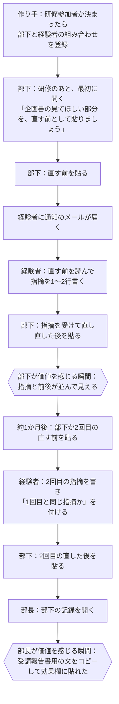

# 仕様（2027-02-07 ステップ2 完了／2027-03-末 作り直し）

## 作り直し（2027-03-末）の要点
3月の試し使い（05-value-test.md）で「会う（15分）」が成り立たず、本人が作り直しを判断。本人「会うのは手段で、本体は指摘の言葉と2回目の比較」。
- 要件④：「経験者と15分話す」→「経験者が『直す前』を読んで、指摘を1〜2行書く」（会わない）
- 順番（本人選択 1-a）：部下が「直す前」を貼る → 経験者が指摘を書く → 部下が直して「直した後」を貼る。理由「3月で懲りたので、経験者を待つのは不安ですけど、指摘を受けてから直すのが大事なので」
- 指摘を書く人：部下（旧 4-b）→ **経験者**
- 経験者の気づき方（本人選択 2-a）：Lists 標準の通知（記録が増えたらメール）
- 2回目：約1か月後、同じ経験者。経験者が2回目の指摘を書くとき「1回目と同じ指摘か」も付ける
- 成功の指標：「2回目の15分」→「2回目の指摘」で、1回目と同じ指摘を受けなかった部下が半分以上（7月末まで）
- 最小の密度：経験者は会わずに書くだけになったため、1人2人までの上限は見直してよい（今回は据え置き）
- 試作品で確かめること1「15分が流れずに続くか」→「経験者が指摘を書くのが止まらずに続くか（部下を待たせないか）」

## 工程2の判断（本人の言葉）
「研修に出た部下と社内の経験者の15分を記録して、部長が受講報告書に前後の変化を書けるようにするものを、Teamsか共有ドライブの範囲で作る」
- 入れないもの・預かるデータは、本文の「今回は入れないもの」「データの重さ」に本人の言葉で記録済み

本人の発言は「」で残す。AIの要約には「要約：」と付ける。「案」と付いたものは本人の確認待ち。

## 戦略（なぜ作るのか）🔴 ✅

### ユーザーのニーズ（部長）
「受講報告書の効果欄に、部下の企画書の前と後と、経験者に言われたことを貼って出せていて、人事から問い合わせが来ない状態、ですかね。部長が『今年はちゃんと書けた』って思える感じ」（2027-02-01）

### 事業としての目的
「私の目的は『部下が育つこと』です。そもそも去年の自分みたいな人を助けたかったので。書けることはその結果、というか、育ったのを見せる手段だと思ってます」（2027-02-01）
- 要約：ニーズ（部長がちゃんと書ける）は、目的（部下が育つ）を見せる手段という位置づけ

### 成功の指標
- 案（2027-02-01）：「経験者に言われた指摘を、次の企画書では言われる前に直せていること、ですかね。仮に『2回目の15分相談で、1回目と同じ指摘を受けなかった人が半分以上』とか」
- 2回目の想定：「1回目から1か月後くらいに、同じ経験者と、のつもりです。2週間の試し使いでは測れないと思うので、成功の指標は4月の研修のあと、7月までで見ることにしてください」
- 成功の指標（仮決め）：4月の研修後〜2027年7月末までに、1回目から約1か月後の2回目の15分（同じ経験者）で、1回目と同じ指摘を受けなかった部下が半分以上

### 最小の密度（利用者どうしの関わり）
- 経験者1人が受け持てる部下：「1人2人までかな、と思います」【推測】
- 経験者（2027-02-03、部長たちへのメールで確認）：企画部2人、営業部1人、生産技術部1人、総務の課長、③さんの先輩の計6人が「15分ならいい」【コミット：時間の約束（弱）】
- 要約：受け持てる部下は最大で約12人（6人×2人）。4月の研修参加者（3部署×1〜2人＝3〜6人）は収まる
- 注意：総務の課長は、以前「忙しくて、最近は流れがち」とされた人【行動】

## 要件（何を作るのか）🔴

### 機能の仕様（優先度順）
優先度（2027-02-03 本人）：「4→1→2→3です。経験者と話したこと自体が育成の中身なので一番上」

| 順 | 機能（本人の言葉） | する（案） | しない（案） |
|---|---|---|---|
| 1 | ④（作り直し）経験者の指摘1〜2行 | 経験者が、部下の「直す前」を読んで指摘を1〜2行書く。2回目には「1回目と同じ指摘か」も付ける | 会わない。会話やチャットはしない |
| 2 | ①「企画書の直す前と後が並んで見られること」 | 指摘を受けた箇所の「直す前」と「直した後」の**抜粋だけ**を並べて見せる（3-b） | 企画書のファイルは預からない。添削や評価はしない |
| 3 | ②「そのまま受講報告書の効果欄に貼れる形で出てくること」 | 部下1人分の記録（日付・指摘・前と後・2回目の結果）を、効果欄に貼れる文章にまとめて出し、コピーできる | 人事のシステムへ直接は出さない |
| 4 | ③「部長は手を動かさなくていいこと（部下か課長がやる）」 | 入力は部下（直す前・直した後）と経験者（指摘・2回目の「同じ指摘か」）。部長は見るだけ・コピーするだけ | 部長に入力や承認を求めない |

本人の選択（2027-02-05）：1-a、2-a、3-b、4-b。理由「経験者の手間はなるべく増やしたくないので」。本人の問い「でも1-aと4-bって矛盾しますか？」

### 1-a と 4-b の関係（2027-02-07 決定）
- 要約：厳密な矛盾ではない。ただし ①経験者は2回目だけ道具を開く必要がある ②経験者は、部下が書いた1回目の指摘（部下の受け取り方の言葉）を見て「同じか」を判断することになる
- 本人の選択：1-a のまま。2回目の15分の終わりに、経験者がその場で「はい／いいえ」を付ける（経験者の手間は1回だけ）

### 「直した後」の貼り忘れ（2027-02-07 決定）
- 本人「部下が『前と後を貼る』のを忘れそうな気はします」
- 本人の選択：機能は足さない。忘れるかどうかを「試作品で確かめること」に加える（2-c）。画面には「直した後がまだです」と出す

### 運営：部下と経験者の組み合わせ（2027-02-07 決定）
- 本人の選択 b：「私が決めます」。4月の研修参加者が決まった時点で、作り手（本人）が一度だけ組み合わせを決めて登録する（6〜12人分）。日程は部下が経験者と調整する（道具の外、Teamsの予定表など）
- 理由になる記録：担当者は自分からは相談しない（6人中1人）【行動】、部長は手を動かさない（必須③）

### 要件と証拠の対応（工程2の確認）
| 必須の要件 | 対応する課題の証拠 |
|---|---|
| ④ 15分の記録 | ③さんが評価に関係ない先輩に30分聞いて助かった【行動】、総務部長が課長に育成を頼んだ【行動】。**ただし「15分が流れずに続く」「15分で育つ」は【推測】**（試作品で確かめること1） |
| ① 前と後 | 部長たちが「何が変わったか」を示せなかった（企画・営業・生産技術）【行動】 |
| ② 報告書の効果欄に貼れる | 受講報告書の決まり、人事の問い合わせ、書き直しに3時間・1時間【行動】 |
| ③ 部長は手を動かさない | 企画部長が上司の手間1時間を理由にオプションを「やめた」【行動】、営業部は課長が報告書を書いた【行動】 |

### 今回は入れないもの（本人、2027-02-03）
- 「社外の人の参加」
- 「チャット機能」
- 「AIによる添削」
- （あったら嬉しい側から持ち越し）経験者とのやりとりのメモ、何人がどれくらい続けたかの一覧

### コンテンツの要件
| 機能 | 中身 | 誰が用意するか | 頻度 |
|---|---|---|---|
| 1 15分の記録 | 日付・相手・指摘1〜2行 | 部下 | 部下1人あたり2回（4〜6月） |
| 1 15分の記録 | （2回目）1回目と同じ指摘か | 経験者 | 部下1人あたり1回 |
| 2 前と後 | 指摘を受けた箇所の前と後の抜粋 | 部下 | 15分のたびに1回 |
| 3 報告書用の文 | 1〜2をまとめた定型の文 | 自動でまとめる（定型文の組み立て。AIは使わない） | 7月末までに1回 |
| 説明文 | 使い方・初回の案内・貼る量の目安「指摘に関係する部分だけ、1〜3文で」（2027-02-09 試作で追加、本人選択 1-a） | 作り手（本人）が最初に一度書く | 一度だけ |

- 見える範囲（2-a）：部下は自分の記録だけ、経験者は担当する部下の記録だけ、部長は自分の部署の部下の記録だけ。困った書き込み（社外秘の持ち出し・個人への攻撃など）は、見える範囲をこの3者に絞ることで防ぐ

## データの重さ 🔴（2027-02-07 本人確認：「中」で確定）
- 預かるもの：部下と経験者の名前、15分の日付、指摘の文、企画書の「直す前・直した後」の抜粋（3-b。ファイルは預からない）
- 分類：**中**（業務データ。未公開の新規事業の企画＝社外秘を含む。指摘は個人の仕事ぶりへの評価に近く、見える範囲を絞る）
- 「重」（マイナンバー・健康・財務の詳細など）は扱わない
- 置き場所の社内ルール（2027-02-07、情シスに確認）：「社内の共有ドライブかTeamsなら社外秘を置いてOK。外部のクラウドサービスは申請が必要で1か月くらいかかる」【行動：社内ルール】
  - 要約：試作品の期限（2/28）と4月の研修を考えると、外部クラウドの申請は間に合わない可能性が高い。ステップ4の道具選びでは、社内の共有ドライブかTeamsの範囲で動く案を中心に示す

## AI利用の上限
- 「AIによる添削」は入れないため、AIは使わない。報告書用の文は定型の組み立てで作る。上限の設定は不要

## 構造（案）🟡
呼び名は、聞き取りで相手が使っていた言葉に合わせた（「受講報告書」「効果の欄」「指摘」「経験者」「15分」「直す前・直した後」）。

### 情報の構造
```
部下ごとの「育成の記録」
├── 1回目の15分（日付・経験者・指摘1〜2行・直す前／直した後）
├── 2回目の15分（日付・同じ経験者・指摘1〜2行・「1回目と同じ指摘か」・直す前／直した後）
└── 受講報告書用の文（1回目と2回目から自動でまとめる）
```

| 使う人 | 画面 | 見られるもの（Q2 で確定） |
|---|---|---|
| 部下 | 自分の育成の記録／15分の記録をつける | 自分の記録だけ |
| 経験者 | 担当する部下の一覧／指摘を書く | 担当する部下の記録だけ |
| 部長 | 自分の部下の一覧／部下の記録／受講報告書用の文 | 自分の部署の部下の記録だけ |

### 利用の流れ（初回から「価値を感じる瞬間」まで）


### 操作の設計
（2027-03-末 作り直し：日付の登録はなくし、「部下が直す前を貼る → 経験者が指摘を書く → 部下が直した後を貼る」に変更。下の表は旧版。新版は prototype と lists-setup.md を正とする）

| 操作 | システムの応え | 失敗したとき・取り消したいとき |
|---|---|---|
| 部下：15分の相手と日付を登録 | 記録に「指摘を書く」欄が出る | 日付や相手を後から直せる。指摘を書く前なら取り消せる |
| 部下：指摘を書く | 記録に指摘が並ぶ | あとから直せる。1〜2行を超えたら「短くしてください」と出す |
| 経験者：2回目に「1回目と同じ指摘か」を付ける | 1回目と2回目の指摘が並び、結果が残る | 付け直せる |
| 部下：直す前・直した後を貼る | 指摘の下に前と後が並ぶ | 貼り直せる。空のままなら「まだ貼っていません」と表示 |
| 部長：受講報告書用の文をコピー | 1回目・2回目がそろっていれば文が出る | そろっていなければ「2回目の15分がまだです」と、足りないものを示す |

### 初回（まだ何もない状態）に見せるもの
- 部下：「研修のあと、最初の15分の相手と日付を入れましょう」と、経験者の一覧
- 経験者：「担当の部下が15分を登録すると、ここに出てきます。経験者にお願いするのは、2回目の15分のあとに『1回目と同じ指摘か』を付けることだけです」
- 部長：「部下が15分の記録をつけると、ここに出てきます。部長の入力は要りません」

## 層の対応表
| 戦略（ニーズ／目的） | 要件（機能・コンテンツ） | 構造（どの流れ・どの画面） | 骨格（画面の部品） | 表層（見た目の扱い） |
|---|---|---|---|---|
| 目的：部下が育つ／成功の指標：2回目で同じ指摘を受けない | 1 15分の記録（指摘1〜2行は部下、同じ指摘かは経験者） | 部下の「指摘を書く」、経験者の「同じ指摘か」 | 画面1の各回の「指摘」欄／画面2の「同じ指摘だった・違う指摘だった」ボタン | |
| 目的：育ったことを見せる | 2 前と後 | 部下の「直す前・直した後を貼る」 | 画面1の「直す前｜直した後」の2つ並び、最上部の「次にやること」 | |
| ニーズ：効果欄に貼って出せる | 3 報告書用の文 | 部長の「受講報告書用の文をコピー」 | 画面3の「効果の欄に貼る文」と「文をコピー」ボタン | |
| ニーズ：部長が手を動かさない（企画部長がオプションを「やめた」理由） | 4 部長は見るだけ | 部長の画面は見る・コピーだけ | 画面3に入力欄を置かない。部下ごとのタブ | |
| 運営：組み合わせ（本人が一度だけ） | 組み合わせの登録 | 作り手の表 | 画面4（表に直接書く） | |
