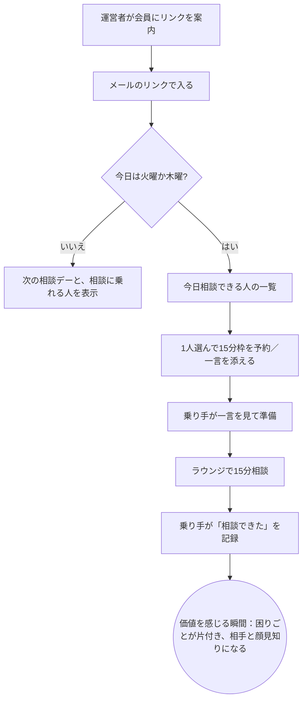

# 仕様設計（ステップ2）｜状態：完了（2026-11-29頃）

## 戦略（なぜ作るのか）🔴
- ユーザーのニーズ（使い終わったとき変わっていてほしいこと）：「佐藤さんの困りごとが一つ片付いてて、相手の会員と顔見知りになってること」【推測】
- 事業としての目的：「他のスペースに月額で売ってうちの売上の柱をもう一本作ること」
- 成功の指標：「1月末までに、うちの会員60人のうち10人が使って、そのうち5人が2回目も使った」
  - 数え方：「使った」＝実際に会って相談した回のみ。予約だけは数えない（「数え方はそれでいい」）
  - 本人（オーナー）が乗り手になった回は分けて数える（1-A）。オーナーに見せる数字は「会員どうしで何件」
  - 撤退基準（2026年2月末までにオーナー5人中1人が申込書）との関係：1月末の自社の結果を、2月にオーナーへ見せる材料にする
- 最小の密度：「平日の昼は20人くらい来てる。その中で3人くらい乗れる人が出てれば聞けそうかな。昼の12〜15時」【推測】
  - 乗り手の現状：「山本さん以外に誰がいるかはわからないな」→ 供給側が最大の未確認点。宿題④で確かめる
  - 決定：**B 週2日の「相談デー」（火・木 12〜15時）**。必要な枠は週6。理由：「火木なら私も受付にいるし、最悪私が乗り手になればいい」

## 要件（何を作るのか）🔴
### 機能の仕様（優先度順）
1. **相談を申し込む**：会員が、火木の相談デーに表示された乗り手から1人を選び、15分の枠を予約する。困りごとの一言（40字まで）とジャンルを添える。しないこと：チャット、乗り手の評価
   - 困りごとの一言：**見えるのは予約した乗り手1人だけ**。理由：「乗り手が準備できるほうがいいし、荒れるのは面倒」。他の会員に見えないので見回りはしない
2. **相談に乗る**：乗り手が、火木12〜15時の中で15分枠を出す。受けた相談の一言を事前に見る。相談後に「相談できた／相手が来なかった」を記録する（成功の指標を数えるため）
3. **今月のつながり（運営者）**：会員どうしの相談件数、相談した人数、2回目の人数、オーナーが乗った件数（別枠）、ジャンル別件数
4. **月額プラン（運営者）**：**テスト用の決済**（本物のお金は動かない）。理由：「やっぱり決済まで動いてるのを見たいし、オーナーに見せるとき説得力あるでしょ」。仮の金額「月5,000円」【仮置き。価格はステップ6で本人が決める。決めるまでオーナーには金額を伏せる案あり】
- 本人確認（マイナンバーカード）：**入れない**。「トラブルは…ないな。入会時に免許証見せてもらってるし」【行動】。他スペースの入会確認はオーナー宿題（質問8）で確かめる

- ステップ4で変更（本人の判断「1-A、2-A、3-B」）：予約時の乗り手へのメール通知は試作では入れない（「受けた相談」に表示）／乗り手の招待はメールを自動送信しない（運営者が登録しURLを伝える）／「相談に乗れる人」の人数は運営者を除く

### コンテンツの要件
| 中身 | 誰が用意 | 頻度 |
|---|---|---|
| 乗り手の表示名・得意分野・一言の自己紹介（写真なし） | 乗り手本人（運営者が招待） | 登録時。ステップ3で追加：「C。うちは顔見知りだし、写真集めるの面倒」。他スペースでは顔見知りの前提が崩れうる【推測】 |
| 困りごとの一言 | 相談する会員 | 毎回 |
| ブログ「相談に乗れる会員の紹介」 | 本人 | 週1回（了解をもらえた会員のみ）。読み手：自社の会員。目的：「会員が読んで、相談してみようって思ってほしい」 |
| 入力欄の注意書き「金額やマイナンバーなど具体的な数字は書かないでください」 | AIが最初に1回作る | 1回 |

### 2026-12-03頃 要件に戻した機能（本人の判断）
- **「今日やること」の書き込み**：2段目から戻し、15分相談と同時に検証する。「同時に入れちゃだめ？見せるのは参加者だけ、荒れたら私が消す」
  - 見えるのは：試作の参加者（運営者が登録したメールの人）だけ
  - 困った書き込みの止め方：運営者が消す（運営者に削除の操作が要る）
  - 根拠の強さ：黒板60人中5人【行動】、B町Slack停止【行動】はどちらも逆向き。本人の仮説「スマホなら書く」【推測】を確かめる
  - データの重さ：軽〜中（参加者に見える自由記述）。何日で消すかは未決

### 今回は入れない（「入れないのは、会員同士のチャット、今日やることの書き込み、マイナンバー確認。評価は…欲しいけど我慢する」）
- 会員どうしのチャット
- ~~「今日やること」の見せ合い（2段目）~~ → 2026-12-03頃 本人の判断で要件に戻した（上記）
- マイナンバーカードによる本人確認（他スペース導入時に再検討）
- 相談後の評価（「欲しいけど我慢する」）

## 構造（どうつながるか）🟡 AI案・本人確認済み（「この順でいい」）
- 運営者の画面では、困りごとの一言は見せず**ジャンル別の件数だけ**を出す（A）。一言は乗り手だけが見る（要件の決定と一致させた）
- ステップ3で追加：運営者の画面に「まだ一度もつながっていない会員」の名前一覧を出す（⑥B「退会しそうな人に声かけたいから」）。会員が使ったかどうかを運営者が個人単位で見る（データの重さ：軽／利用の記録）。説明：入会時＋試作の参加者には最初に一言
- 通知とログインはメール。本人の気がかり：「佐藤さんはメール見ないかも。LINEの方がいい気がするけど…まあいいや、それで」【推測。本人が承知で残す】→ 試作のテスト（ステップ4・5）で、メールのリンクから実際に入れたかを見る
### 情報の構造（呼び名はインタビューの言葉を優先）
- **会員**：ホーム「今日相談できる人」→ 申し込み → 「わたしの予約」
- **乗り手**（画面上の呼び名は「相談に乗れる人」）：「枠を出す」→「受けた相談」（一言を見る）→ 相談後の記録
- **運営者**：「今月のつながり」／「相談に乗れる人を招待」／「月額プラン」
- ログイン：メールに届くリンクで入る（パスワードを持たない）
- 一人が会員と乗り手を兼ねられる（山本さんも相談する側になりうる）

### 利用の流れ（初回から「価値を感じる瞬間」まで）

### 操作の設計（失敗・取り消し・初回）
| 操作 | うまくいったとき | 失敗・取り消し |
|---|---|---|
| 予約 | 予約完了と時刻・場所を表示、乗り手にメール | 枠が埋まっていたら「他の人」を表示。開始前ならどちらからでも取り消せ、相手にメール |
| 相談当日 | — | 相手が来なかったら「来なかった」を記録（指標に数えない）。もう一度予約する導線を出す |
| 乗り手が0人の日 | — | 「今日はまだ相談できる人がいません。受付に声をかけてください」と表示（運営者が乗り手になれる） |
| 月額プラン | テスト決済の完了画面 | 失敗したら決済サービスの理由を表示し、もう一度試せる |
| 初回（誰もいない状態） | 運営者に「まず相談に乗れる人を3人招待しましょう」を表示 | — |

## データの重さ 🔴（本人確認済み）
| データ | 重さ | 扱い |
|---|---|---|
| 表示名、メールアドレス、得意分野、予約の時刻、利用の記録 | 軽 | |
| 運営者の決済情報 | 中 | Stripe が持ち、こちらでは持たない |
| 困りごとの一言（40字） | 中 | **30日後に自動で消す**（B）。理由：「オーナーに見せるのに使いたい」。入力欄に注意書き |
- 重いデータ（マイナンバー等）：扱わない

## AI利用上限
- 最初の版でAIを使う機能はない（上限は不要）

## 要件と課題検証の対応（工程2のゲート）
| 必須の要件 | 対応する証拠 |
|---|---|
| 相談を申し込む | 佐藤さんの3月の相談、受付相談2週間で4件【行動】 |
| 相談に乗る | 山本さんが30分相談に乗った【行動】。ただし乗り手が集まるかは未確認（宿題④）【推測】 |
| 今月のつながり（運営者） | 自社の退会1件「誰とも話さないし家でいいかな」【行動】。他スペースのオーナーが見たいかは未確認【推測】 |
| 月額プラン（テスト決済） | オーナーが払うかは未確認【推測】。本人の希望で入れる（撤退基準で確かめる） |

## 層の対応表
| 戦略（ニーズ／目的） | 要件（機能・コンテンツ） | 構造（どの流れ・どの画面） | 骨格 | 表層 |
|---|---|---|---|---|
| 困りごとが一つ片付く | 相談を申し込む（一言40字・乗り手のみ閲覧） | 会員：今日相談できる人→申し込み | ②申し込みA：1画面に乗り手・時刻・一言欄・予約ボタン | |
| 相手の会員と顔見知りになる | 15分の対面予約／乗り手の名前・得意分野・自己紹介（写真なし） | 予約完了→ラウンジで15分 | ①ホームA：乗り手カードの一覧（一番大事：誰がいるか）／③予約完了：時刻を大きく | |
| 相談が実際に起きたかを数える（成功の指標） | 乗り手が相談後に記録 | 乗り手：受けた相談 | ⑤「相談できた」「相手が来なかった」 | |
| 事業：他スペースに月額で売る（売上の柱） | 今月のつながり／月額プラン（テスト決済） | 運営者：今月のつながり・月額プラン | ⑥B：件数＋まだつながっていない会員の名前一覧（ボタンなし）／⑧テスト表示つき申し込み | |
| 退会を防ぐ（「誰とも話さないし家でいいかな」） | まだつながっていない会員を運営者が知る | 運営者：今月のつながり | ⑥Bの名前一覧 | |
| 会員が「相談してみよう」と思う | ブログ週1（相談に乗れる会員の紹介） | アプリの外（ブログ）→ 招待リンク | （アプリ外） | |
| 最小の密度（火木に乗り手3人） | 乗り手が枠を出す／招待 | 乗り手：枠を出す／運営者：招待 | ④枠を出す（火木の時刻を選ぶ）／⑦招待（初回は「まず3人」） | |
| （共通） | メールのリンクで入る | 共通 | ⑨メール入力→リンク送信（期限切れ時は再送） | |
